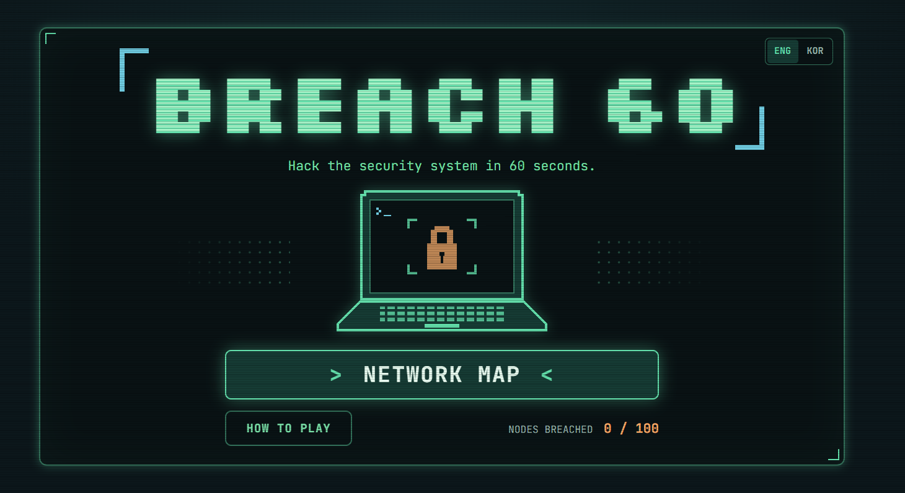

# BREACH 60

**BREACH** — 보안을 뚫고 침입하다.

60초 안에 암호를 해독하고 보안 시스템을 돌파하는 레트로 터미널 스타일의 해킹 퍼즐 웹게임입니다.

PC와 모바일에서 별도 설치 없이 플레이할 수 있습니다.

## Play Now

**[▶ PLAY BREACH 60](https://jivvoow.github.io/BREACH60/)**

## Preview
<p align="center">
  
</p>


## Features

- **60-Second Challenge** — 제한 시간 안에 모든 보안 레이어 돌파
- **Dynamic Puzzles** — 매번 새롭게 생성되는 암호, 경로, 기억력, 패턴 퍼즐
- **Network Map** — 100개 노드로 구성된 맵, 현재 20개 레벨 플레이 가능
- **Progressive Difficulty** — 레벨별로 높아지는 난이도
- **Hack Tools** — 시간 추가, 방패, 힌트 아이템
- **Retro UI** — 픽셀 아트와 터미널 스타일의 해킹 연출
- **Local Save** — 진행도와 최고 기록 자동 저장
- **Multi-Platform** — PC·모바일 및 한국어·영어 지원

## How to Play

1. **NETWORK MAP**에서 도전할 노드를 선택합니다.
2. **START BREACH**를 누르면 60초 카운트다운이 시작됩니다.
3. 암호 해독, 네트워크 연결, 숫자 기억, 패턴 분석 등의 퍼즐을 해결합니다.
4. 모든 보안 레이어를 돌파하면 **ACCESS GRANTED!**
5. 시간이 0이 되면 **ACCESS DENIED!**

오답을 제출하면 시간이 차감되며, 남은 시간이 많을수록 높은 점수를 획득합니다.

## Tech Stack

- **Frontend:** HTML5, CSS3, Vanilla JavaScript (ES Modules)
- **Build Tool:** Vite
- **Storage:** localStorage
- **Deployment:** GitHub Pages
- **Testing:** Node.js Test Runner

## Getting Started

Node.js 20 이상이 필요합니다.

```bash
npm install
npm run dev
```

기타 명령어:

```bash
npm test        # 테스트
npm run build   # 배포용 빌드
npm run preview # 빌드 미리보기
```

## Project Structure

```text
src/
├── config.js       # 게임 설정
├── levels.js       # 레벨 데이터
├── tools.js        # 아이템 데이터
├── i18n.js         # 다국어 지원
├── game/           # 게임 상태, 타이머, 점수
├── puzzles/        # 퍼즐 생성 및 검증
└── ui/             # 화면 및 인터랙션

tests/              # 게임 로직 테스트
```

## Roadmap

- [x] 타이머 및 암호 해독 시스템
- [x] 네트워크 경로 및 패턴 퍼즐
- [x] 레벨 시스템과 기록 저장
- [ ] Log Analysis 퍼즐
- [ ] Data Extraction 퍼즐
- [ ] Easy / Hard 난이도 및 사운드

## Deployment

GitHub Actions를 통해 `main` 브랜치 업데이트 시 자동으로 테스트, 빌드 및 GitHub Pages 배포가 진행됩니다.

---

**60 SECONDS. 100 NODES. ONE MISSION.**

*Can you breach the system before time runs out?*
